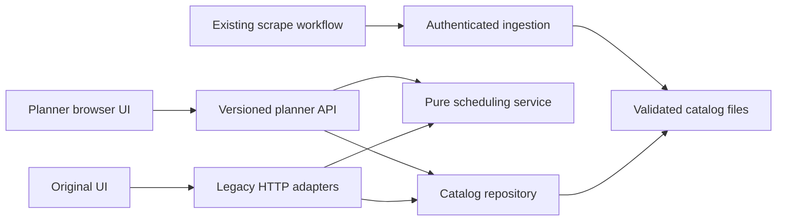
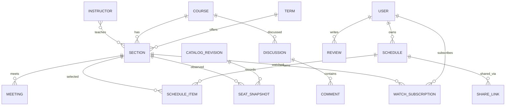

# FCS architecture decisions

## 1. Keep Flask and build a modular monolith

Flask already fits the current hosting setup. Replacing the entire stack would combine a migration with product discovery. Keep one application, separate domain services, and add persistence when it becomes necessary. Use `create_app()` for isolated tests and retain `app:app` for WSGI.



The browser owns temporary planner state and display. The server resolves section IDs against its authoritative catalog and generates combinations. Browser-supplied times, credits, or instructors are never scheduling authority.

## 2. Normalize the legacy dataset at the boundary

The text file remains the ingestion format for this iteration. `CatalogRepository` reads it into explicit fields. A section has a term-local ID (`department:number:section`), a course key, credits, instructor, seat counts, and a list of meetings. All lecture/lab meetings participate in clashes.

Term is a separate namespace in drafts and generation requests. IDs alone are not globally unique. A future database should use internal stable IDs, retaining source identifiers as a uniqueness constraint per institution and term.

The repository searches the root and `scraper/`, validates term codes, and invalidates its cache when the active term, resolved path, modification time, or size changes. Replacing files atomically avoids partial reads. Cache state is local to each WSGI worker; each worker checks file metadata on access.

File modification time is exposed as `file_modified_at`, not a scrape timestamp. The UI explicitly says capture time is unavailable. The catalog also exposes a content hash revision; generation rejects requests from a stale browser revision. A future persisted CatalogRevision should contain source, captured_at, received_at, source hash, parser version, and completeness measurements.

## 3. Search with pruning and explicit limits

The new generator groups alternative sections by course and chooses at most one per group. It prunes time clashes and excess credits during recursion, includes required courses, and uses a remaining-credit upper bound to stop impossible branches. Adjacent time intervals are allowed: overlap is `start_a < end_b && start_b < end_a` on a shared day.

Limits: at most 60 input sections, 50 returned schedules, and 100,000 visited search nodes. A `limited` result is not proof that every option was found. Ordering is deterministic by required status, alternative count, and course key; it is not a quality ranking. Fractional and zero credits are preserved. Unannounced times cannot be verified and are disclosed in the UI.

Next: blocked personal time, travel buffers, section locks, preferred-day ranking, and richer catalog revision history. Keep these as scheduling input types and pure rules; HTTP should only validate and serialize.

## 4. Separate page structure, styling, and behavior

The new planner uses one template, one stylesheet, and one JavaScript module. It has no CDN runtime dependencies. Data-derived HTML is escaped. The UI uses native inputs, semantic regions, focus indicators, modal dialog behavior, and live status messages. Responsive layout stacks the catalog above the calendar on small screens; the calendar can scroll horizontally. Print rules retain the chosen view.

The JavaScript module currently combines state transitions and rendering. As features grow, extract pure planner state operations, persistence adapters, API client, and calendar/catalog components before adding accounts or collaboration. A framework becomes useful if measured interface complexity warrants it; it is not required for this iteration.

## 5. Device drafts now; server schedules later

JSON format:

```json
{
  "version": 1,
  "term": "2027SP",
  "section_ids": ["COMP:102:A"],
  "shortlist_ids": ["COMP:102:A", "COMP:102:B"],
  "required_course_keys": ["COMP:102"]
}
```

Only catalog references are imported. Unknown sections are reported, the term must match, input size is limited, IDs are deduplicated, and required keys must remain in the shortlist. The draft is saved under `fcs:planner:v1:<term>`. Imports replace current state. Clear-shortlist leaves the displayed week intact. Export is a backup, not a public share link.

Future server schedules need versioned writes and conflict responses for concurrent edits. Shared schedules need independent read-only tokens and explicit revocation. Do not turn local draft IDs into access tokens.

## 6. Harden ingestion while preserving deployment

The existing webhook contract remains `term_code` plus `content`, with `X-Webhook-Token`. A configured secret is mandatory and comparisons use constant-time matching. Term codes cannot create arbitrary paths. Data is parsed before replacement. Responses avoid exposing server exception details. The app limits request bodies to 2 MB. `.env` values do not override existing environment values, and development debug mode is opt-in.

The data file and ACTIVE_TERM pointer are each replaced atomically. They are not one multi-file transaction; if the pointer write fails, the existing active catalog remains selected and the new data can be retried. Ingestion across simultaneous webhook requests is not yet serialized. Before adding notification processing, move ingestion to revision transactions and a durable outbox.

## Future persistence model



Reviews should have a subject type and validated reference to a course or instructor, plus term, author, moderation state, and timestamps. Separate reusable academic identity from term-specific availability. Migrations should be reversible where practical and data backfills should be idempotent.

## API boundaries

Current: `GET /api/v1/catalog`, `POST /api/v1/schedules/generate`. Legacy routes are thin adapters to the same repository and solver. Planned: schedules and versions, revocable shares, watch subscriptions, course/instructor reviews, discussions, reports, and moderation actions.

Use authentication and ownership checks on every persisted user resource. Pagination belongs in review and discussion APIs. Seat events should be processed after ingestion commits, never from a page request. Keep account, review, moderation, and notification data separate from scraper files.

## Verification and operations

Unit tests cover scheduling parity against exhaustive enumeration on a small dataset, alternate meetings, adjacency, decimal credits, and limits. API tests cover invalid input, missing catalogs, legacy adapters, and webhook rejection. CI runs these checks on supported Python versions and checks JavaScript syntax.

Before production expansion: add structured ingestion logs, monitoring for stale snapshots, concurrency tests, real browser regression tests in CI, source parser fixtures, backup/recovery verification, and deployment health checks. Before social publishing: authorization tests, moderation tooling, reporting, rate limits, and deletion policies.
